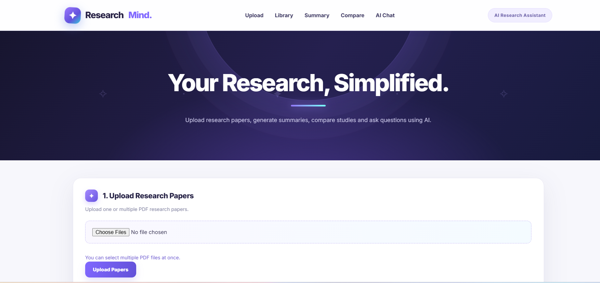
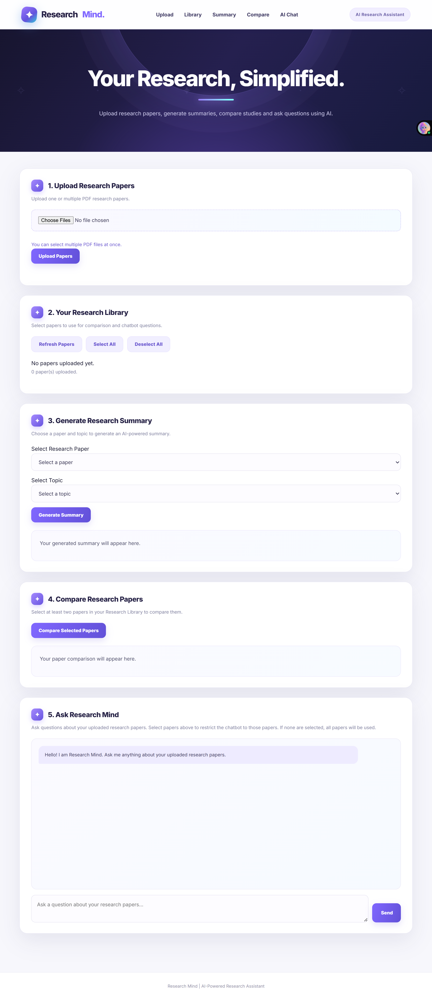

# 🔬 ResearchMind – AI-Powered Research Assistant

ResearchMind is an AI-powered research assistant designed to simplify academic research and literature reviews. It allows users to upload multiple research papers, generate summaries, compare research findings, and interact with an AI chatbot to get answers based on research documents.

The platform helps students and researchers understand complex academic papers, extract meaningful insights, and save time during the literature review process.

## ✨ Key Features

- **Multiple PDF Upload:** Upload multiple research papers for analysis.
- **AI-Powered Summarization:** Generate detailed summaries of research papers.
- **Research Paper Comparison:** Compare multiple papers to identify similarities, differences, and key findings.
- **Interactive AI Chatbot:** Ask questions and get answers based on uploaded research documents.
- **Document-Based Question Answering:** Retrieve relevant information from research papers to support answers.
- **Literature Review Assistance:** Simplify the process of understanding and analyzing academic research.

## 🛠️ Technology Stack

- **Programming Language:** Python
- **Backend:** Flask
- **AI/LLM Integration:** Groq API
- **LLM Framework:** LangChain
- **Vector Database:** FAISS
- **Frontend:** HTML, CSS, JavaScript
- **Document Processing:** PDF text extraction and processing

## 🖥️ Application Screenshots

### Homepage


### Full Website Preview



## ⚙️ Installation and Setup

### 1. Clone the Repository

```bash
git clone https://github.com/GauravSaini50/ResearchMind.git
cd ResearchMind
```

### 2. Create a Virtual Environment

```bash
python -m venv venv
```

Activate the environment:

**Windows:**
```bash
venv\Scripts\activate
```

**Linux/macOS:**
```bash
source venv/bin/activate
```

### 3. Install Dependencies

```bash
pip install -r requirements.txt
```

### 4. Configure Environment Variables

Create a `.env` file in the root directory using `.env.example` as a template.

Add your credentials and model configuration:

```env
GROQ_API_KEY=your_groq_api_key
LLM_MODEL=your_llm_model_name
EMBEDDING_MODEL=your_embedding_model_name
```

Get your Groq API key from [Groq Console](https://console.groq.com/keys).

**Important:** Never upload your actual `.env` file or API keys to GitHub.

### 5. Run the Application

Run the Flask application using your project's main application entry point.

## 📁 Project Structure

```text
ResearchMind/
│
├── src/
│   ├── DetectandSplitsections.py
│   ├── LoadandText.py
│   ├── create_vectordb.py
│   ├── getsummary.py
│   └── rag_retrivalchain.py
│
├── templates/
│   └── index.html
│
├── static/
│
├── uploads/
│
├── research_paper_vector_db/
│
├── .env.example
├── .gitignore
├── requirements.txt
├── README.md
└── app.py
```

## 🎯 Project Objective

The primary objective of ResearchMind is to make academic research more accessible and efficient by combining document processing, AI-powered summarization, research comparison, and conversational question answering in one platform.

## 🚀 Future Enhancements

- Support for additional document formats.
- Improved accuracy of document-based question answering.
- Research paper citation and reference extraction.
- Advanced comparison of research methodologies and findings.
- Export research summaries and reports.

## 👨‍💻 Author

**Gaurav Saini**

GitHub: [GauravSaini50](https://github.com/GauravSaini50)

---

*ResearchMind – Making Research Smarter, Faster, and Easier.*